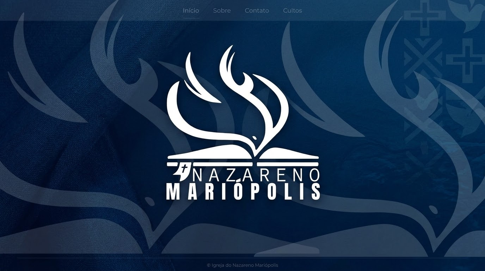

<div align="center">
  

  # Igreja do Nazareno em Mariópolis

  **Um lugar de fé, comunhão, adoração e esperança.**

  [Acesse o site](https://nazarenomariopolis.github.io/) · [Instagram](https://instagram.com/nazarenomariopolis) · [Facebook](https://www.facebook.com/nazarenomariopolis)
</div>

---

## Sobre o projeto

Site institucional da **Igreja do Nazareno em Mariópolis**, criado para aproximar a comunidade e acolher quem deseja conhecê-la. Em uma experiência responsiva e acessível, reúne informações sobre a igreja, horários de cultos, notícias, localização e formas de contato.



## O que você encontra

- **Apresentação da igreja** e da sua comunidade.
- **Horários de cultos e encontros**, incluindo a Escola Bíblica Dominical.
- **Notícias e novidades** da igreja.
- **Identidade e história**, com informações sobre a fé e a missão da comunidade.
- **Localização**, endereço e mapa interativo.
- **Contato** por e-mail e acesso às redes sociais.

## Design e experiência

A identidade visual combina azul-marinho, dourado e tipografia contemporânea. O layout adapta-se a dispositivos móveis e inclui navegação responsiva, cartões informativos, animações sutis e mapa interativo.

## Tecnologias

- HTML5, CSS3 e JavaScript
- [Bootstrap 5](https://getbootstrap.com/) e Bootstrap Icons
- [Leaflet](https://leafletjs.com/) para o mapa
- Google Fonts: DM Sans e Manrope
- OpenStreetMap como fonte de dados cartográficos

O site é estático e não requer instalação de dependências nem etapa de build. Para visualizar localmente, clone o repositório e abra `index.html` no navegador. Como o mapa, as fontes e alguns recursos são carregados de serviços externos, é necessária uma conexão com a internet para exibir tudo corretamente.

## Estrutura

```text
.
├── index.html          # Página do site e estilos/scripts incorporados
├── image-preview.jpg   # Imagem de prévia para compartilhamento
├── logo-1024.webp      # Logo em alta resolução
├── logo-512.webp       # Logo e ícone do site
├── nazareno-mariopolis.jpg
├── thumbnail.jpg       # Imagem de destaque
└── favicon.ico
```

## SEO e compartilhamento

A página inclui metadados para mecanismos de busca, cartões Open Graph e Twitter, além de dados estruturados **Schema.org** para identificar a igreja e apresentar informações de contato e localização.

## Contato e localização

**Endereço:** Rua Leopoldina Borges, 266 — Mariópolis, RJ, Brasil  
**E-mail:** [nazarenomariopolis@gmail.com](mailto:nazarenomariopolis@gmail.com)

## Licença

© Igreja do Nazareno em Mariópolis. Todos os direitos reservados.
